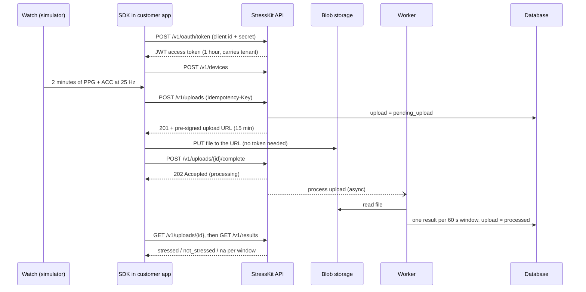

# StressKit demo

A small, working example of how a wearable health feature reaches the cloud and comes back as a result: a mock watch produces PPG and accelerometer data, a Python SDK uploads it over HTTPS, the API stores and processes it, and the customer reads one stress label per minute.

It runs on a laptop today with no cloud account. Later milestones move each part to AWS without changing the API contract.

> **Not a medical device.** The "model" is a heart-rate threshold for illustration. All credentials in this repo are public demo values.

## How it fits together



| Part | Today (local) | On AWS (milestones 4 to 6) |
|---|---|---|
| API | FastAPI + uvicorn | API Gateway HTTP API + Lambda (FastAPI via Mangum) |
| Raw files | `.data/blobs` folder, HMAC-signed URLs | S3 with pre-signed PUT URLs |
| Metadata and results | In-memory store | DynamoDB (partition key starts with the tenant) |
| Async processing | FastAPI background task | SQS queue + worker Lambda + dead-letter queue |
| Secrets | Env vars (demo defaults) | SSM Parameter Store |
| Logs and alarms | Console | CloudWatch |

## Run it

Needs Python 3.11 or newer.

```bash
git clone https://github.com/Janenarongkl/stresskit-demo.git
cd stresskit-demo
python -m venv .venv
# Windows PowerShell: .venv\Scripts\Activate.ps1     macOS/Linux: source .venv/bin/activate
pip install -e ".[dev]"

pytest -q                      # 23 tests
python scripts/demo.py         # the whole flow in one process, every HTTP call printed
```

Run the API as a real server and use it from the browser:

```bash
uvicorn stresskit_api.main:app --reload
# open http://127.0.0.1:8000/docs  (Authorize with demo-clinic-a / demo-secret-a)
python scripts/demo.py --base-url http://127.0.0.1:8000    # in a second terminal
```

Demo output (step 5):

```
14:20  not_stressed   68.0 bpm  quality=good
14:21  not_stressed   68.0 bpm  quality=good
14:22  stressed      105.0 bpm  quality=good
14:23  stressed      105.0 bpm  quality=good
14:24  na               --      quality=motion
14:25  na               --      quality=motion
```

## API contract (v1)

Full contract: [`docs/openapi.json`](docs/openapi.json) (also served at `/docs`). A test fails if it drifts from the code.

| Method and path | What it does | Success |
|---|---|---|
| `POST /v1/oauth/token` | OAuth 2.0 client credentials, form-encoded. Returns a JWT | 200 |
| `POST /v1/devices` | Register a device for your tenant | 201 |
| `GET /v1/devices/{device_id}` | Read a device | 200 |
| `POST /v1/uploads` | Create an upload and get a pre-signed URL. Send `Idempotency-Key` | 201 |
| `PUT /v1/blobs/{key}?expires=&signature=` | Upload the file (local stand-in for S3) | 200 |
| `POST /v1/uploads/{id}/complete` | Start processing | 202 |
| `GET /v1/uploads/{id}` | `pending_upload`, `processing`, `processed` or `failed` | 200 |
| `GET /v1/results?device_id=` | One result per 60 s window | 200 |

Design rules the contract follows:

- **Tenant from the token, never the body.** Another tenant's ids return 404, not 403, so ids leak nothing.
- **Big files bypass the API** through short-lived pre-signed URLs.
- **Retries are safe.** Same `Idempotency-Key` and body returns the same upload (`Idempotent-Replayed: true`); same key with a different body is 409. `/complete` can be called twice.
- **Slow work is async.** `/complete` returns 202 and the client polls (webhooks in milestone 6).
- **Errors are `application/problem+json`** with `type`, `title`, `status`, `detail`.
- **Versioned path** (`/v1`), so a breaking change becomes `/v2` while v1 keeps working.

Recording file format (`PUT` body): `{"sample_rate_hz": 25, "ppg": [..], "acc": [[x, y, z], ..]}`; ACC in g, both lists the same length.

## Repo layout

```
src/stresskit_api/   the cloud side: routes, auth, storage, worker, mock model
src/stresskit_sdk/   the customer SDK (token refresh, upload, retries, errors)
src/stresskit_sim/   mock watch: calm, stressed and moving recordings
scripts/demo.py      narrated end-to-end run
scripts/export_openapi.py
docs/PRD.md          one-page product brief and milestones
docs/openapi.json    the API contract
tests/               auth, upload flow, idempotency, tenant isolation, model
```

## Configuration

| Variable | Default | Notes |
|---|---|---|
| `STRESSKIT_JWT_SECRET` | demo value | Set a long random value anywhere outside a laptop |
| `STRESSKIT_BLOB_SIGNING_KEY` | demo value | Same |
| `STRESSKIT_CLIENTS` | two demo clinics | JSON: `{"id": {"secret": "...", "tenant_id": "..."}}` |
| `STRESSKIT_DATA_DIR` | `.data` | Where uploaded files go (git-ignored) |
| `STRESSKIT_PUBLIC_BASE_URL` | request host | Host used in upload URLs behind a proxy |
| `STRESSKIT_TOKEN_TTL_S`, `STRESSKIT_UPLOAD_URL_TTL_S` | 3600, 900 | |

## Milestones

- [x] 1. Layout, mock wearable, local API
- [x] 2. API contract: auth, devices, uploads, results, errors, idempotency, OpenAPI
- [ ] 3. SDK: offline buffer, chunked uploads, packaged release
- [ ] 4. AWS storage: S3, DynamoDB, IAM
- [ ] 5. AWS compute: API Gateway, Lambda, SQS + DLQ, SAM deploy
- [ ] 6. Webhooks, CloudWatch dashboard and alarms, cost review
