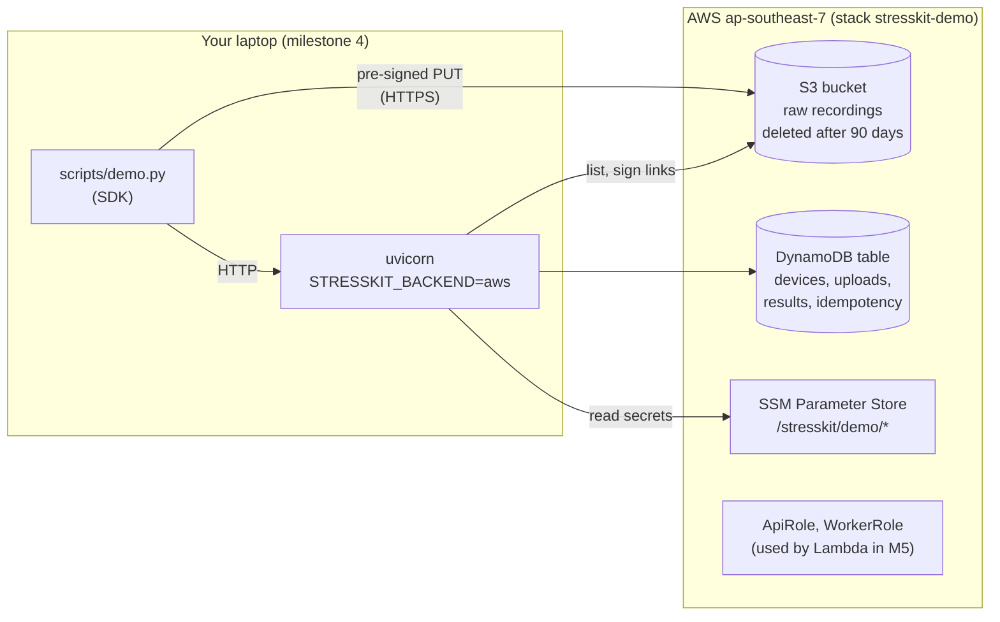

# Deploy milestone 4: S3, DynamoDB and IAM

What this creates, in your account, in ap-southeast-7 (Thailand):



In milestone 4 the API still runs on your laptop, using your own AWS sign-in. Milestone 5 moves it into Lambda behind API Gateway and gives it `ApiRole`.

Expected cost: close to $0 (see [../cost.md](../cost.md)).

## 0. Once: install the tools

- [AWS CLI v2](https://docs.aws.amazon.com/cli/latest/userguide/getting-started-install.html) and [SAM CLI](https://docs.aws.amazon.com/serverless-application-model/latest/developerguide/install-sam-cli.html).
- In this repo: `pip install -e ".[aws]"`.

## 1. Sign in

Use the IAM Identity Center user you created (see the account setup guide), not the root user.

```bash
aws configure sso          # once: SSO start URL, region ap-southeast-7, profile name "stresskit"
aws sso login --profile stresskit
export AWS_PROFILE=stresskit AWS_REGION=ap-southeast-7
aws sts get-caller-identity   # shows your account id: you are signed in
```

## 2. Put the secrets in SSM Parameter Store

Make your own values. Never reuse the public demo values from `settings.py` on AWS.

```bash
JWT_SECRET=$(python -c "import secrets; print(secrets.token_urlsafe(48))")
SECRET_A=$(python -c "import secrets; print(secrets.token_urlsafe(24))")
SECRET_B=$(python -c "import secrets; print(secrets.token_urlsafe(24))")

aws ssm put-parameter --name /stresskit/demo/jwt-secret --type SecureString --value "$JWT_SECRET"
# Two clinics (tenants), so the demo can show that one cannot see the other's data.
aws ssm put-parameter --name /stresskit/demo/clients --type SecureString --value "{
  \"clinic-a\": {\"secret\": \"$SECRET_A\", \"tenant_id\": \"tenant-clinic-a\"},
  \"clinic-b\": {\"secret\": \"$SECRET_B\", \"tenant_id\": \"tenant-clinic-b\"}}"
echo "clinic-a: $SECRET_A   clinic-b: $SECRET_B"   # keep these in a password manager
```

## 3. Deploy the stack

```bash
cd infra
sam validate --lint
sam deploy            # settings come from samconfig.toml; answer "y" to the change set
```

`sam deploy` shows what it will create (a bucket, a table, two roles and a bucket policy) and waits for "y". At the end it prints the outputs. Save two of them:

```bash
export STRESSKIT_BUCKET=<BucketName output>
export STRESSKIT_TABLE=<TableName output>
```

## 4. Run the API against AWS

```bash
export STRESSKIT_BACKEND=aws STRESSKIT_SSM_PREFIX=/stresskit/demo
uvicorn stresskit_api.main:app --port 8000
```

## 5. Run the demo

In a second terminal:

```bash
python scripts/demo.py --base-url http://localhost:8000 \
  --client "clinic-a:$SECRET_A" --other-client "clinic-b:$SECRET_B"
```

Then look in the AWS console: the recording is in the S3 bucket under `tenant-clinic-a/`, and the DynamoDB table (Explore items) has items whose keys all start with `TENANT#tenant-clinic-a#`.

## 6. Checks only real AWS can do

The tests run against moto, a local stand-in for AWS that does not check signatures. Check these once by hand and record them in the AWS column of [../product/traceability.md](../product/traceability.md):

| Check | How | Expected |
|---|---|---|
| Changed URL is refused (SK-21) | Take an `upload_url`, change one letter of the key, `curl -X PUT -H "Content-Type: application/json" -d '{}' "<url>"` | `403 SignatureDoesNotMatch` |
| Expired URL is refused (SK-21) | Same `curl` with an unchanged URL after 15 minutes | `403 AccessDenied` (Request has expired) |
| Bucket is private (SK-21) | Open `https://<bucket>.s3.ap-southeast-7.amazonaws.com/` in a browser | `AccessDenied` |
| HTTP is refused (SK-21) | Same with `http://` | `AccessDenied` |
| Tags (SK-26) | Console: Resource Groups and Tag Editor, tag `project=stresskit-demo` | Bucket, table, both roles |
| Idle cost (SK-29) | Cost Explorer after a week, filter by tag | Under $1 |

## 7. Remove everything

The bucket must be empty before CloudFormation can delete it.

```bash
aws s3 rm "s3://$STRESSKIT_BUCKET" --recursive
cd infra && sam delete
aws ssm delete-parameters --names /stresskit/demo/jwt-secret /stresskit/demo/clients
```

`sam delete` also removes the deployment bucket SAM created for its own files (`resolve_s3`) when asked.
