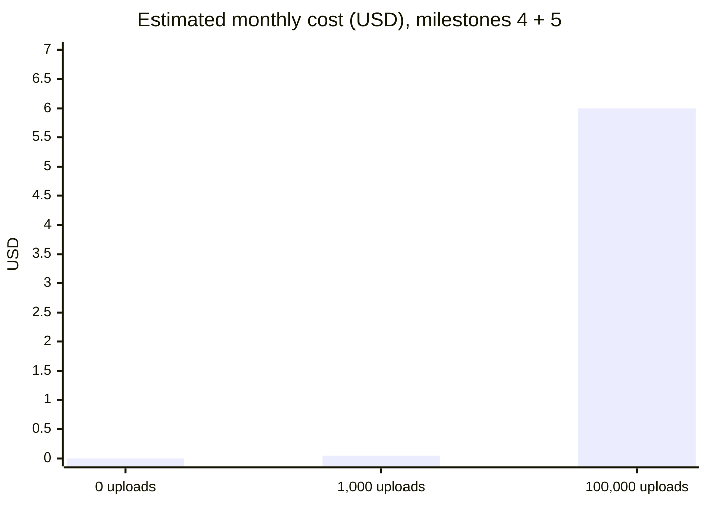

# What the demo costs on AWS (SK-29)

An estimate made before the first deploy, so the bill is never a surprise. Everything is pay-per-use: no servers run while nobody uses the demo, so **idle cost is close to $0**.

## Assumptions

| | Value | Why |
|---|---|---|
| One upload | a 2-minute recording, about 105 KB | 25 Hz PPG + 3-axis accelerometer as JSON (`stresskit_sim`) |
| Raw files kept | 90 days, then deleted (decision D15) | No storage-class change: files under 128 KB are billed as 128 KB in the cheaper tiers, so moving them would cost more |
| API calls per upload | about 8 | token, create upload, complete, about 3 status polls, results |
| DynamoDB per upload | about 6 writes and 10 reads | upload, idempotency key, status changes, 2 results; device and status reads |
| S3 per upload | 1 PUT, 1 LIST, 1 HEAD, 1 GET | upload, "has it arrived?", size check, worker read |

Prices are list prices rounded **up** from the larger regions, because ap-southeast-7 (Thailand) is new and its prices are usually the same or lower. Replace them with the [AWS Pricing Calculator](https://calculator.aws/) figures for ap-southeast-7 when the stack is first deployed.

## Estimate per month

| Service | What is billed | 0 uploads | 1,000 uploads | 100,000 uploads |
|---|---|---|---|---|
| **Milestone 4** | | | | |
| S3 storage | $0.025 per GB-month, about 3 months of files kept | $0.00 | $0.01 | $0.80 |
| S3 requests | $0.005 per 1,000 PUT/LIST, $0.0004 per 1,000 GET/HEAD | $0.00 | $0.01 | $1.10 |
| DynamoDB on-demand | $1.50 per million writes, $0.30 per million reads | $0.00 | $0.01 | $1.20 |
| DynamoDB storage and backups | $0.29 per GB-month, PITR $0.23 per GB-month; well under 1 GB | $0.00 | $0.00 | $0.05 |
| SSM Parameter Store | Standard parameters are free | $0.00 | $0.00 | $0.00 |
| **Milestone 4 total** | | **$0.00** | **about $0.03** | **about $3.20** |
| **Milestone 5 (planned)** | | | | |
| API Gateway HTTP API | $1.30 per million requests | $0.00 | $0.01 | $1.05 |
| Lambda | 1 million requests and 400,000 GB-seconds a month free | $0.00 | $0.00 | $0.00 |
| SQS | 1 million requests a month free | $0.00 | $0.00 | $0.00 |
| CloudWatch Logs | $0.70 per GB ingested, about 1 KB per request | $0.00 | $0.01 | $0.60 |
| **Milestones 4 + 5 total** | | **$0.00** | **about $0.05** | **about $5–6** |

Not counted: data transfer out to the internet (100 GB a month is free), and AWS Budgets, which are free for alert-only budgets ([pricing](https://aws.amazon.com/aws-cost-management/aws-budgets/pricing/)).

## Guardrails

- **Alerts:** AWS Budgets email at $1, $5 and $10 of monthly spend (set up on 21 Oct 2026).
- **Credits:** $100 of AWS credits are applied before any card charge.
- **Nothing hourly:** no EC2, RDS, NAT gateway or load balancer. `tests/test_template.py` fails if one is added.
- **Removing it all:** empty the bucket, then `sam delete` (CloudFormation cannot delete a bucket that still has files; see [aws/deploy-m4.md](aws/deploy-m4.md) step 7). Raw files also delete themselves after 90 days.
- **Check after a week:** Cost Explorer, filtered by tag `project=stresskit-demo`, should show under $1.

## Known risk: very large uploads (NFR7)

On S3 an upload link cannot cap the file size the way the local API's `413` does, so a signed-in customer could send a file much larger than 10 MB. The worker marks it `failed` without reading it (decision D17), but the file is still stored.

- **How bad:** one link allows one file of up to 5 GB, for 15 minutes. Kept for 90 days that is about $0.40 at most, and every link needs a valid token, so it is traceable to one customer.
- **Mitigation now:** the $1, $5 and $10 budget alerts; the 90-day expiry.
- **Fix if needed (milestone 5 or later):** switch to a pre-signed POST, whose policy can set a maximum size (`content-length-range`), or let the worker delete oversize files.

