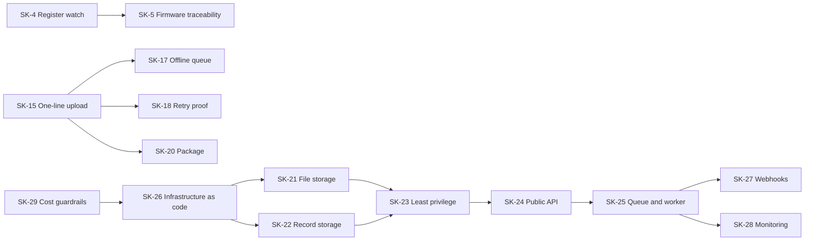

# StressKit product backlog

Epics, user stories and acceptance criteria for the demo. Each story has an ID that the [traceability matrix](traceability.md) and commit messages can refer to.

Every story carries one line of fields:

- **Type:** *Feature* (something a persona uses) or *Enabler* (work that makes features possible, such as infrastructure or test coverage).
- **Priority:** MoSCoW for the demo. Must = the demo is not credible without it.
- **Points:** relative size (1, 2, 3, 5, 8). Used to compare and to load milestones, not to promise dates.
- **Milestone and status:** Done (built and tested), Planned, or Later (not scheduled).
- **Depends on:** stories that must be done first.

Acceptance criteria use Given / When / Then. Every criterion of a Done story has **Evidence**: a named test, or a "Manual check" line where a test does not make sense.

## Personas

| Persona | Who they are | What they care about |
|---|---|---|
| **Customer developer** | Builds the clinic's or wellness company's phone app and integrates our SDK | Clear contract, few surprises, errors they can act on, one-day integration |
| **Clinic reviewer** | A nurse, coach or HR wellness lead who looks at results in the customer's dashboard | One honest label per minute, knowing when data is unreliable |
| **Wearer** | The person wearing the watch | Privacy, battery, results that match how they felt |
| **Operations engineer** | Runs StressKit in the cloud | Failed uploads are visible, tenants stay apart, deployments are repeatable |
| **Product owner** | Owns the roadmap and the model's place in it | Traceability from a result back to the data, model version and firmware |
| **Account owner** | Pays the AWS bill for the demo | No surprise costs; everything can be switched off |

## Epic map

| Epic | Goal | Milestones | Status |
|---|---|---|---|
| E1 Customer access | Each customer signs in as a machine and only ever acts as their own tenant | 2 | Done |
| E2 Device registry | Watches are registered so results can be traced to hardware and firmware | 2, 3 | Done |
| E3 Upload recordings | Large recordings reach storage safely over unreliable phone networks | 2 | Done |
| E4 Processing and results | Each minute gets an honest label with quality and model version | 2 | Done |
| E5 Developer experience | A developer can integrate in a day from the SDK, docs and errors | 2 | Done |
| E6 SDK release and robustness | The SDK installs like any package and survives offline periods | 3 | Done |
| E7 Run on AWS | Same contract, serverless in ap-southeast-7, with a capped cost | 4, 5 | Planned |
| E8 Notify and operate | Customers hear when results are ready; we see failures before customers do | 6 | Planned |

## Milestone load

| Milestone | Stories, in order | Points |
|---|---|---|
| 1–2 Local API and contract | SK-1 to SK-4, SK-6 to SK-16 | 39, done |
| 3 SDK and traceability | SK-18, SK-20, SK-5, SK-17 | 12, done |
| 4 AWS foundations | SK-29, SK-26, SK-21, SK-22, SK-23 | 12, built; deploy check pending |
| 5 AWS compute | SK-24, SK-25 | 10 |
| 6 Notify and operate | SK-28, SK-27 | 8 |
| Later | SK-19 (8), SK-30 to SK-34 (not sized) | |

Remaining planned work: 18 points, plus the milestone 4 deploy check. A comfortable milestone for one person is 8 to 13 points.

### Milestone 3 ranking (WSJF)

Weighted shortest job first: (user value + time criticality + risk reduction) ÷ size, each scored 1 to 10. Highest goes first.

| Story | Value | Time | Risk | Size | WSJF | Decision |
|---|---|---|---|---|---|---|
| SK-18 Prove retries never duplicate | 3 | 3 | 8 | 2 | 7.0 | M3, first |
| SK-20 Install the SDK as a package | 5 | 2 | 2 | 2 | 4.5 | M3 |
| SK-5 Firmware traceability | 5 | 3 | 5 | 3 | 4.3 | M3 |
| SK-17 Keep recordings while offline | 8 | 5 | 5 | 5 | 3.6 | M3 |
| SK-19 Upload long sessions in parts | 3 | 1 | 2 | 8 | 0.8 | Later |

SK-19 is deferred: 2-minute demo recordings are about 105 KB, so multipart upload solves a problem the demo does not have yet. See decision D12.

### Dependencies

---

## E1 Customer access

### SK-1 Get an access token
**As a** customer developer, **I want** to exchange my client ID and secret for a short-lived token, **so that** my app never sends the long-lived secret on every call.

Feature · Must · 3 points · M2 · Done · Depends on: none

- **Given** a valid client ID and secret, **when** the app calls `POST /v1/oauth/token` with `grant_type=client_credentials`, **then** it gets `200` with a bearer token and `expires_in = 3600`.
- **Given** a token, **when** it is decoded, **then** it names the tenant (`tenant_id`), has an expiry and is signed by StressKit.
- **Given** a wrong secret, **when** the app asks for a token, **then** the answer is `401` as `application/problem+json` and no token is issued.
- **Given** any grant type other than `client_credentials`, **when** the app asks for a token, **then** the answer is `422`.

Evidence: `test_token_has_tenant_claim`, `test_wrong_secret_is_401_problem_json`, `test_unsupported_grant_type_is_422`

### SK-2 Reject calls without a valid token
**As an** operations engineer, **I want** every data call to require a valid, unexpired token, **so that** nobody reaches health data without signing in.

Feature · Must · 2 points · M2 · Done · Depends on: SK-1

- **Given** no `Authorization` header, **when** any `/v1` data endpoint is called, **then** `401` with `WWW-Authenticate: Bearer`.
- **Given** an expired token, **when** it is used, **then** `401` with detail "Token expired."
- **Given** a token signed with any other key, **when** it is used, **then** `401`.

Evidence: `test_missing_token_is_401` (checks the header), `test_expired_token_is_401`, `test_token_signed_with_other_key_is_401`

### SK-3 Keep tenants apart
**As a** clinic reviewer, **I want** another customer to be unable to see or even detect our devices, uploads and results, **so that** our patients' data stays private.

Feature · Must · 3 points · M2 · Done · Depends on: SK-1

- **Given** Clinic B's valid token, **when** it asks for Clinic A's device, upload or results by ID, **then** the answer is `404`, the same as for an ID that does not exist.
- **Given** both clinics register a device with the same ID, **when** each reads its results, **then** each sees only its own.
- **Given** Clinic B's token, **when** it calls `/complete` on Clinic A's upload, **then** `404` and nothing is processed.
- **Given** any request, **when** the API decides which tenant's data to use, **then** it uses the tenant in the token; no request field can choose the tenant.

Evidence: `test_tenant_isolation`. Manual check for the third criterion: no request model in `models.py` has a tenant field.

---

## E2 Device registry

### SK-4 Register a watch
**As a** customer developer, **I want** to register each watch with its model and firmware version, **so that** results can be traced back to the hardware that produced them.

Feature · Must · 2 points · M2 · Done · Depends on: SK-1

- **Given** a new device ID (letters, digits, `-` and `_`, up to 64 characters), **when** the app calls `POST /v1/devices`, **then** `201` with the stored device and `created_at`.
- **Given** the same device ID again for the same tenant, **when** it is registered, **then** `409` and nothing changes.
- **Given** an invalid device ID, **when** it is registered, **then** `422` as problem+json.
- **Given** a registered device, **when** its tenant calls `GET /v1/devices/{device_id}`, **then** `200` with the device.

Evidence: `test_duplicate_device_is_409`, `test_bad_device_id_is_422_problem`, `test_end_to_end_with_sdk`, `test_tenant_isolation`

### SK-5 Trace results to firmware
**As a** product owner, **I want** each upload to record the firmware version the watch had at the time, and to update a device's firmware version after an upgrade, **so that** when a result is questioned we know which firmware produced the data.

Feature · Should · 3 points · M3 · Done · Depends on: SK-4

- **Given** a registered device, **when** the app sends `PATCH /v1/devices/{id}` with a new `firmware_version`, **then** `200` and the device shows the new version.
- **Given** a new upload, **when** it is created, **then** it stores the device's current `firmware_version`, and `GET /v1/uploads/{id}` returns it.
- **Given** a device upgraded after an upload, **when** that older upload is read, **then** it still shows the old firmware version.
- **Given** any result, **when** it is read, **then** its `upload_id` leads to the firmware version (no need to copy it onto every result).
- **Given** another tenant's or an unknown device, **when** it is patched, **then** `404` and nothing changes.

Evidence: `test_patch_records_a_firmware_upgrade`, `test_uploads_keep_the_firmware_they_were_recorded_with`, `test_result_leads_to_firmware_through_its_upload`, `test_patch_unknown_or_other_tenants_device_is_404`

---

## E3 Upload recordings

### SK-6 Upload a recording without passing it through the API
**As a** customer developer, **I want** to get a one-time upload link and send the file straight to storage, **so that** large recordings upload quickly and the API stays small and cheap.

Feature · Must · 5 points · M2 · Done · Depends on: SK-4

- **Given** a registered device, **when** the app calls `POST /v1/uploads` with `device_id`, `started_at`, `sample_rate_hz` and `duration_s`, **then** `201` with an `upload_id`, status `pending_upload`, an `upload_url` and `upload_url_expires_at`.
- **Given** an upload link, **when** it is inspected, **then** it writes exactly one file (`tenant/device/upload_id.json`) and expires 15 minutes after it was issued.
- **Given** a valid link, **when** the app `PUT`s the file without a bearer token, **then** `200` with the stored size.
- **Given** a link whose path or expiry was changed, or that has expired, **when** it is used, **then** `403`.
- **Given** a file larger than the limit (10 MB by default), **when** it is sent, **then** `413` as problem+json and nothing is stored.
- **Given** `duration_s` below 60 or above 86,400 (one day), **when** the upload is created, **then** `422`.

Evidence: `test_upload_url_is_for_one_file_and_expires_in_15_minutes`, `test_tampered_or_expired_upload_url_is_403`, `test_file_over_size_limit_is_413`, `test_duration_outside_one_minute_to_one_day_is_422`, `test_end_to_end_with_sdk`

### SK-7 Retry safely after a network drop
**As a** customer developer, **I want** to retry an upload request with the same `Idempotency-Key` and get the same upload back, **so that** a lost reply never creates duplicates.

Feature · Must · 3 points · M2 · Done · Depends on: SK-6

- **Given** a request that already succeeded, **when** the same key and the same body are sent again, **then** `201` with the same `upload_id` and `Idempotent-Replayed: true`.
- **Given** a key already used, **when** it is sent with a different body, **then** `409` and nothing new is created.
- **Given** two clinics happen to send the same key, **when** each creates an upload, **then** each gets its own upload; keys are scoped to the tenant.
- **Given** the SDK creates an upload, **when** it sends the request, **then** it always includes an `Idempotency-Key`.

Evidence: `test_idempotency_key_replays_same_upload`, `test_idempotency_key_with_different_body_is_409`, `test_idempotency_keys_are_per_tenant`. Manual check for the third criterion: `create_upload()` in `client.py` always sets the header.

### SK-8 Start processing only when the file is there
**As an** operations engineer, **I want** processing to start only after the file is in storage, and only once, **so that** the worker never runs on a missing file or twice for one upload.

Feature · Must · 2 points · M2 · Done · Depends on: SK-6

- **Given** the file was uploaded, **when** the app calls `POST /v1/uploads/{id}/complete`, **then** `202` with status `processing`, without waiting for processing to finish.
- **Given** no file was uploaded yet, **when** `/complete` is called, **then** `409` and the upload stays `pending_upload`.
- **Given** `/complete` was already called, **when** it is called again, **then** it returns the current state and processing is not queued a second time.

Evidence: `test_end_to_end_with_sdk` (first answer is `processing`), `test_complete_before_file_is_409`, `test_complete_twice_queues_processing_once`. Response time is measured on AWS under NFR1.

---

## E4 Processing and results

### SK-9 One label per minute
**As a** clinic reviewer, **I want** one result per 60-second window, labelled `stressed`, `not_stressed` or `na`, **so that** I can see when during the session stress happened.

Feature · Must · 5 points · M2 · Done · Depends on: SK-8

- **Given** a processed recording, **when** the app calls `GET /v1/results?device_id=`, **then** it gets one item per full 60-second window, oldest first, each with `window_start`, `label`, `heart_rate_bpm`, `signal_quality` and `model_version`.
- **Given** a recording whose last window is shorter than 60 seconds, **when** it is processed, **then** that partial window is ignored.
- **Given** simulated calm (68 bpm) and stressed (105 bpm) recordings, **when** they are processed by the mock model, **then** they are labelled `not_stressed` and `stressed`, with heart rate within 5 bpm of the simulated rate.
- **Given** a `limit` outside 1 to 1,440 (one day of minutes), **when** results are requested, **then** `422`; the default is 100.

Evidence: `test_end_to_end_with_sdk`, `test_partial_window_is_ignored`, `test_heart_rate_is_close_to_simulated`, `test_results_limit_outside_1_to_1440_is_422`

### SK-10 Say "not available" instead of guessing
**As a** wearer, **I want** minutes with too much movement or a poor signal to be marked `na`, **so that** I am never told I was stressed because I was walking.

Feature · Must · 3 points · M2 · Done · Depends on: SK-9

- **Given** a window where the wrist moved too much (accelerometer standard deviation above 0.15 g), **when** it is processed, **then** `label = na`, `heart_rate_bpm = null`, `signal_quality = motion`.
- **Given** a flat or unusable pulse signal, **when** it is processed, **then** `label = na` and `signal_quality = poor_signal`.
- **Given** a recording with a still minute followed by a walking minute, **when** it is processed, **then** only the walking minute is `na`.
- **Given** an `na` window, **when** it is returned, **then** it still has its `window_start` and `model_version`, so the gap is visible rather than missing.

Evidence: `test_end_to_end_with_sdk` (moving scenario), `test_flat_ppg_is_poor_signal`, `test_only_moving_minutes_are_na`

### SK-11 Know when processing is finished
**As a** customer developer, **I want** to read the upload's status, **so that** my app knows when to fetch results or show an error.

Feature · Must · 2 points · M2 · Done · Depends on: SK-8

- **Given** an upload, **when** the app calls `GET /v1/uploads/{id}`, **then** the status is `pending_upload`, `processing`, `processed` or `failed`, and `window_count` once processed.
- **Given** a file that cannot be parsed, **when** it is processed, **then** the upload becomes `failed` with the reason in `error`, and no results are written.
- **Given** an upload that was already processed, **when** it is processed again, **then** its results are overwritten, never duplicated.

Evidence: `test_end_to_end_with_sdk`, `test_bad_file_marks_upload_failed`, `test_reprocessing_overwrites_results`

### SK-12 Trace every result to its model
**As a** product owner, **I want** each result to carry the model version and signal quality, **so that** when a customer questions a label we can say which model and what data quality produced it.

Feature · Must · 1 point · M2 · Done · Depends on: SK-9

- **Given** any result, **when** it is returned, **then** it includes `model_version` (today `mock-hr-threshold-0.1`) and `signal_quality`.
- **Given** a result, **when** `signal_quality` is read, **then** it is one of `good`, `motion` or `poor_signal`.
- **Given** a new model version is deployed, **when** new recordings are processed, **then** their results carry the new version while older results keep theirs.

Evidence: `test_end_to_end_with_sdk`, `test_flat_ppg_is_poor_signal`. Manual check for the third criterion: `processing.py` writes `mock_model.MODEL_VERSION` onto each result at processing time. Firmware traceability is SK-5.

---

## E5 Developer experience

### SK-13 Errors a program can act on
**As a** customer developer, **I want** every error in the same machine-readable shape, **so that** my app can handle them in one place.

Feature · Must · 2 points · M2 · Done · Depends on: none

- **Given** any 4xx or 5xx answer from the API, **when** it is read, **then** it is `application/problem+json` with `type`, `title`, `status` and `detail`.
- **Given** a validation error, **when** it is returned, **then** it also lists the failing fields in `errors`.
- **Given** an error answer, **when** the SDK receives it, **then** it raises `StressKitError` carrying the status and the problem body.

Evidence: `test_wrong_secret_is_401_problem_json`, `test_bad_device_id_is_422_problem`, `test_file_over_size_limit_is_413`, `test_sdk_raises_problem_details`

### SK-14 A published, versioned contract
**As a** customer developer, **I want** the API published as OpenAPI under `/v1`, **so that** I can generate clients and trust that v1 will not change under me.

Feature · Must · 2 points · M2 · Done · Depends on: none

- **Given** the code changes, **when** CI runs, **then** it fails if `docs/openapi.json` no longer matches the running API.
- **Given** any endpoint, **when** its path is read, **then** it starts with `/v1`; a breaking change goes to `/v2` while `/v1` keeps working.
- **Given** a running server, **when** a developer opens `/docs`, **then** interactive docs for the same contract are shown.

Evidence: `test_committed_contract_matches_code`. Manual check for the last two: open `http://127.0.0.1:8000/docs` and read the path list.

### SK-15 Upload in one line
**As a** customer developer, **I want** one SDK call that does the whole upload, **so that** I don't have to learn the three-call flow to get started.

Feature · Must · 3 points · M2 · Done · Depends on: SK-6, SK-8

- **Given** a recording, **when** the app calls `client.upload_recording(device_id, recording, started_at)`, **then** the SDK creates the upload, sends the file and calls `/complete`.
- **Given** a token is held, **when** further calls are made, **then** the SDK reuses it, and gets a new one when less than a minute is left.
- **Given** the server answers `503` (or `429`, other `5xx`, or a network error), **when** the SDK retries up to 3 times and a retry succeeds, **then** the call succeeds.
- **Given** the server keeps failing, **when** the fourth attempt fails, **then** the SDK raises `StressKitError` with the last status.
- **Given** an upload in progress, **when** the app calls `wait_until_processed()` and `get_results()`, **then** it gets the final status and the results.

Evidence: `test_end_to_end_with_sdk`, `test_sdk_reuses_token_and_refreshes_before_expiry`, `test_sdk_retries_server_errors_then_succeeds`, `test_sdk_gives_up_after_three_retries`

### SK-16 Try it in ten minutes
**As a** customer developer (or an interviewer), **I want** a narrated demo that runs with no cloud account, **so that** I can see the whole flow before writing code.

Feature · Should · 1 point · M2 · Done · Depends on: SK-15

- **Given** a clean machine with Python 3.11 or newer, **when** someone follows the README, **then** `pip install -e ".[dev]"`, `pytest -q` and `python scripts/demo.py` all succeed.
- **Given** the demo runs, **when** it finishes, **then** it has printed every HTTP call and a per-minute results table with calm, stressed and moving minutes.
- **Given** a server started with `uvicorn`, **when** the demo runs with `--base-url`, **then** it gives the same result over real HTTP.
- **Given** a pull request, **when** CI runs, **then** it runs the demo on Python 3.11 and 3.13.

Evidence: CI workflow `.github/workflows/ci.yml`. Manual check: run on Windows once before the interview (the user's PC).

---

## E6 SDK release and robustness (milestone 3)

### SK-18 Prove retries never duplicate
**As an** operations engineer, **I need** tests that simulate dropped replies and rate limits, **so that** we know SDK retries never create duplicates or hammer the API.

Enabler · Should · 2 points · M3 · Done · Depends on: SK-15

- **Given** the reply to `POST /v1/uploads` is lost after the server created the upload, **when** the SDK retries, **then** exactly one upload exists and the SDK returns it.
- **Given** a network error on `/complete`, **when** the SDK retries, **then** processing is queued once.
- **Given** a `429` with `Retry-After: 2`, **when** the SDK retries, **then** it waits at least 2 seconds first.
- **Given** a `4xx` other than `429`, **when** the SDK receives it, **then** it does not retry.
- **Given** a `401` on a token the SDK thought was still valid, **when** it is received, **then** the SDK gets one fresh token and tries once more.

Evidence: `test_lost_reply_to_create_upload_gives_one_upload`, `test_network_error_on_complete_queues_processing_once`, `test_retry_after_is_respected`, `test_client_errors_are_not_retried`, `test_401_on_a_cached_token_gets_one_fresh_token`

### SK-20 Install the SDK as a package
**As a** customer developer, **I want** to `pip install` a versioned SDK, **so that** I can pin and upgrade it like any other dependency.

Feature · Should · 2 points · M3 · Done · Depends on: SK-15

- **Given** a release tag such as `sdk-v0.3.0`, **when** CI runs, **then** it builds a wheel for the SDK alone and attaches it to a GitHub release.
- **Given** the wheel, **when** it is installed in a clean environment, **then** `from stresskit_sdk import StressKitClient` works without the server's dependencies.
- **Given** a new version, **when** it is released, **then** the version follows semantic versioning and `CHANGELOG.md` lists its changes.
- **Given** a tag that does not match the version in `sdk/pyproject.toml`, **when** the release workflow runs, **then** it stops without publishing.

Evidence: CI job `sdk-package` runs `scripts/check_sdk_wheel.py` (clean install, version check, no server dependencies); `test_sdk_version_matches_its_package_metadata`, `test_changelog_has_an_entry_for_this_sdk_version`; the release workflow also refuses a tag with no CHANGELOG entry. Manual check: after merging, push tag `sdk-v0.3.0` and confirm the release and its wheel appear on GitHub.

### SK-17 Keep recordings while offline
**As a** wearer, **I want** recordings made without a network to upload later on their own, **so that** no session is lost on a flight or in a basement.

Feature · Must · 5 points · M3 · Done · Depends on: SK-15, SK-18

- **Given** no network, **when** the app uploads a recording, **then** the SDK saves it to a local queue and returns a pending reference instead of failing.
- **Given** queued recordings, **when** the network returns, **then** they upload oldest first, each with the `Idempotency-Key` it was given when queued.
- **Given** queued recordings, **when** the app restarts, **then** they are still queued.
- **Given** the queue has reached its size limit (default 50 MB), **when** another recording is added, **then** the SDK raises a clear error and nothing already queued is dropped.
- **Given** the token expired while offline, **when** the queue drains, **then** the SDK gets a new token first and no upload fails with `401`.
- **Given** an upload link expired while queued, **when** the queue drains, **then** the SDK asks for a new link with the same `Idempotency-Key` and succeeds.
- **Given** a queued recording the server refuses for good (for example, an unknown device), **when** the queue drains, **then** it is set aside in `failed/` with the reason and the rest still upload.
- **Given** the client secret is wrong or was rotated, **when** the queue drains, **then** it stops, keeps every recording queued and says why; nothing goes to `failed/`.

Evidence: `test_offline_upload_is_queued_and_sent_when_back_online`, `test_queue_drains_oldest_first`, `test_queue_survives_an_app_restart`, `test_full_queue_raises_and_keeps_what_it_has`, `test_token_expired_while_offline_does_not_fail_the_drain`, `test_expired_upload_link_is_renewed_with_the_same_key`, `test_refused_recording_is_set_aside_and_the_rest_continue`, `test_bad_secret_keeps_the_whole_queue`

---

## E7 Run on AWS (milestones 4 and 5)

Shared acceptance criteria for every E7 story:

- **Given** the deployed stack, **when** the existing tests and `scripts/demo.py` run against its URL, **then** they pass unchanged.
- **Given** the stack, **when** it is reviewed, **then** it is in ap-southeast-7 (unless a required service is missing there), uses only pay-per-use serverless services (no EC2, RDS or NAT gateway) and no secret is committed.

### SK-29 Cost guardrails before the first deploy
**As the** account owner, **I want** spend alerts and a cost estimate before anything is deployed, **so that** the demo never surprises me with a bill.

Feature · Must · 1 point · M4 · Built, deploy check pending · Depends on: none

- **Given** the AWS account, **when** monthly spend passes $1, $5 or $10, **then** an email alert is sent. (Already set up on 21 Oct 2026.)
- **Given** the planned architecture, **when** `docs/cost.md` is read, **then** it estimates monthly cost at 0, 1,000 and 100,000 uploads.
- **Given** no traffic, **when** the stack has run for a week, **then** Cost Explorer shows under $1.
- **Given** the stack, **when** it is no longer needed, **then** one command removes everything that costs money (see SK-26).

Evidence: [`docs/cost.md`](../cost.md) (about $0 idle, $0.03 at 1,000 and $3.20 at 100,000 uploads a month for milestone 4); `test_no_always_on_compute`. After deploy: Cost Explorer check in [deploy-m4.md](../aws/deploy-m4.md) step 6.

### SK-26 Infrastructure as code
**As an** operations engineer, **I need** every AWS resource defined in one SAM template from the start, **so that** the stack can be created, reviewed and deleted in one command and nothing is set up by hand.

Enabler · Must · 3 points · M4 · Built, deploy check pending · Depends on: SK-29

- **Given** the template, **when** `sam deploy` runs, **then** it creates every resource for the current milestone.
- **Given** a deployed stack, **when** `sam delete` runs, **then** nothing that costs money is left behind.
- **Given** any resource, **when** its tags are read, **then** it has `project=stresskit-demo`.
- **Given** a pull request that changes the template, **when** CI runs, **then** the template passes `cfn-lint` (the linter `sam validate --lint` runs).

Evidence: [`infra/template.yaml`](../../infra/template.yaml) and `infra/samconfig.toml`; CI step `cfn-lint infra/template.yaml`; `test_every_resource_that_takes_tags_is_tagged`. After deploy: `sam deploy` and `sam delete` in [deploy-m4.md](../aws/deploy-m4.md) steps 3 and 7.

### SK-21 File storage for raw recordings
**As an** operations engineer, **I need** an encrypted S3 bucket with one prefix per tenant, **so that** customers can upload recordings straight to durable, cheap storage (enables SK-6 on AWS).

Enabler · Must · 3 points · M4 · Built, deploy check pending · Depends on: SK-26

- **Given** a new upload, **when** the API creates its `upload_url`, **then** it is an S3 pre-signed PUT URL valid for 15 minutes for exactly one key `tenant/device/upload_id.json`.
- **Given** a changed or expired URL, **when** it is used, **then** S3 refuses it with `403`.
- **Given** the bucket, **when** its settings are read, **then** public access is blocked and objects are encrypted at rest.
- **Given** an object older than 90 days, **when** the lifecycle rule runs, **then** it is deleted (D15; no move to a cheaper class, since files under 128 KB cost more there).

Evidence: `test_upload_link_is_s3_scoped_to_one_file_and_short_lived`, `test_sdk_end_to_end_on_s3_and_dynamodb`, `test_bucket_is_private_encrypted_and_https_only`, `test_raw_recordings_expire`, `test_oversize_file_in_s3_is_marked_failed`. The `403` on a changed or expired URL needs real S3 (moto does not check signatures): [deploy-m4.md](../aws/deploy-m4.md) step 6.

### SK-22 Record storage for devices, uploads and results
**As an** operations engineer, **I need** DynamoDB tables keyed by tenant first, **so that** lookups stay fast and one tenant's query can never return another's items (enables SK-3, SK-7 and SK-9 on AWS).

Enabler · Must · 3 points · M4 · Built, deploy check pending · Depends on: SK-26

- **Given** any item, **when** its key is read, **then** the partition key starts with `TENANT#<tenant_id>`.
- **Given** a window that is processed twice, **when** results are written, **then** the sort key `RESULT#<window_start>` makes the second write overwrite the first.
- **Given** an idempotency key, **when** 24 hours pass, **then** it expires by time-to-live.
- **Given** the tables, **when** their settings are read, **then** capacity is on-demand and point-in-time recovery is on.

Evidence: `test_every_item_is_keyed_by_tenant`, `test_other_tenant_cannot_see_device_upload_or_results`, `test_reprocessing_overwrites_results_in_dynamodb`, `test_idempotency_key_replays_then_expires`, `test_table_is_on_demand_with_ttl_and_backups`. One table holds all four kinds of item; the tests create it from the template.

### SK-23 Least-privilege access
**As an** operations engineer, **I need** each function to have only the permissions it uses, **so that** a bug in one part cannot read or change everything.

Enabler · Must · 2 points · M4 · Built, deploy check pending · Depends on: SK-21, SK-22

- **Given** the API function's role, **when** it tries to read a raw file, **then** access is denied; it can only write upload records and create pre-signed URLs.
- **Given** the worker's role, **when** it is reviewed, **then** it can read raw files and write results but cannot read signing keys.
- **Given** the signing keys, **when** a function starts, **then** it reads them from SSM Parameter Store, not from code or plain environment variables.

Evidence: `test_api_cannot_read_recordings_and_worker_cannot_read_secrets`, `test_no_wildcard_actions_or_resources`, `test_secrets_are_read_from_ssm`, `test_missing_ssm_parameters_fail_at_startup`. The roles are attached to the Lambda functions in milestone 5 (SK-24, SK-25).

### SK-24 Public HTTPS API on AWS
**As an** operations engineer, **I need** the API served by API Gateway and Lambda, **so that** customer developers reach the same contract at a public HTTPS address (enables E1 to E5 on AWS).

Enabler · Must · 5 points · M5 · Planned · Depends on: SK-23

- **Given** the deployed URL, **when** `scripts/demo.py --base-url <url>` runs, **then** it completes end to end.
- **Given** normal load, **when** latency is measured in CloudWatch, **then** p95 is under 1 second for every call except the file upload.
- **Given** a client sending more than 20 requests a second, **when** the limit is exceeded, **then** API Gateway answers `429` and costs stay bounded.
- **Given** an HTTP (not HTTPS) request, **when** it is sent, **then** it is refused.
- **Given** a Lambda cold start, **when** the first request arrives, **then** it still answers in under 3 seconds.

### SK-25 Queue and worker for processing
**As an** operations engineer, **I need** `/complete` to send a message to SQS and a worker Lambda to process it, **so that** spikes wait in a queue instead of failing and broken files are set aside (enables SK-8 to SK-11 on AWS).

Enabler · Must · 5 points · M5 · Planned · Depends on: SK-24

- **Given** a 2-minute recording, **when** `/complete` is called, **then** the upload is `processed` within 30 seconds at p95.
- **Given** 100 uploads completed within one minute, **when** they are processed, **then** all of them finish and none are lost.
- **Given** a message that fails 3 times, **when** the third attempt fails, **then** it moves to the dead-letter queue and the upload becomes `failed`.
- **Given** the same message is delivered twice, **when** both are processed, **then** one set of results exists.
- **Given** the worker times out, **when** the message becomes visible again, **then** it is retried and counts toward the 3 attempts.

---

## E8 Notify and operate (milestone 6)

### SK-28 See failures before customers do
**As an** operations engineer, **I want** a dashboard and alarms, **so that** I know about failed uploads, slow processing or a filling dead-letter queue.

Feature · Should · 3 points · M6 · Planned · Depends on: SK-25

- **Given** the CloudWatch dashboard, **when** it is opened, **then** it shows uploads per hour, processing time p95, error rate by status code and the share of `na` windows.
- **Given** any message in the dead-letter queue, **when** it arrives, **then** an email alarm is sent.
- **Given** 5xx answers above 1% for 5 minutes, or processing p95 above 30 seconds, **when** the threshold is crossed, **then** an email alarm is sent.
- **Given** any log line, **when** it is read, **then** it is JSON with `tenant_id`, `upload_id` and a request ID, and contains no raw signal data.

### SK-27 Webhook when results are ready
**As a** customer developer, **I want** a signed webhook when an upload is processed or failed, **so that** my app doesn't have to poll.

Feature · Should · 5 points · M6 · Planned · Depends on: SK-25

- **Given** a tenant, **when** it registers an HTTPS webhook URL, **then** it gets a signing secret, shown once.
- **Given** an upload finishes, **when** the event `upload.processed` or `upload.failed` is sent, **then** it carries `event_id`, `upload_id`, `device_id`, status and a timestamp.
- **Given** an event, **when** the customer verifies it, **then** an HMAC-SHA256 signature header over the body and timestamp proves it came from StressKit.
- **Given** the customer's endpoint is down, **when** delivery fails, **then** it is retried with back-off for up to 24 hours, then recorded as undelivered.
- **Given** an event delivered twice, **when** the customer receives it, **then** the same `event_id` lets them ignore the repeat.

---

## Later (not scheduled)

### SK-19 Upload long sessions in parts
**As a** customer developer, **I want** sessions longer than 30 minutes to upload in parts, **so that** a dropped connection does not restart a large upload.

Feature · Could · 8 points · Later · Depends on: SK-17, SK-21

Deferred by the milestone 3 ranking (decision D12). When it is picked up, split it into two stories: multipart upload, then per-part retry.

- **Given** a file above 5 MB, **when** it is uploaded, **then** it is sent in parts of at most 5 MB, each with its own pre-signed URL.
- **Given** one part fails, **when** the SDK retries, **then** only that part is sent again.
- **Given** a part fails permanently (3 retries), **when** the upload gives up, **then** the parts already stored are cleaned up and the upload becomes `failed`.
- **Given** the token expires mid-upload, **when** the next part is sent, **then** the SDK gets a new token and continues.
- **Given** all parts arrive, **when** the upload completes, **then** the results are the same as for a single-part upload of the same data.

### Not yet sized

| ID | Story | Why it is parked |
|---|---|---|
| SK-30 | As a clinic reviewer, I want results filtered by date range and paged, so that long histories load quickly | `limit` covers the demo; add `from`, `to` and a cursor before real customers |
| SK-31 | As a wearer, I want my data deleted on request, so that I control my health data (PDPA right to erasure) | Needed for production; keys and prefixes already allow deleting by tenant and device |
| SK-32 | As a customer developer, I want to rotate my client secret without downtime | Needs two active secrets per client |
| SK-33 | As a product owner, I want to run a new model version on old recordings and compare, so that model upgrades are measured before release | Raw data is already kept for this; needs a reprocessing job and a comparison report |
| SK-34 | As a customer developer, I want SDKs for Kotlin and Swift | Python is enough to demonstrate the contract |
